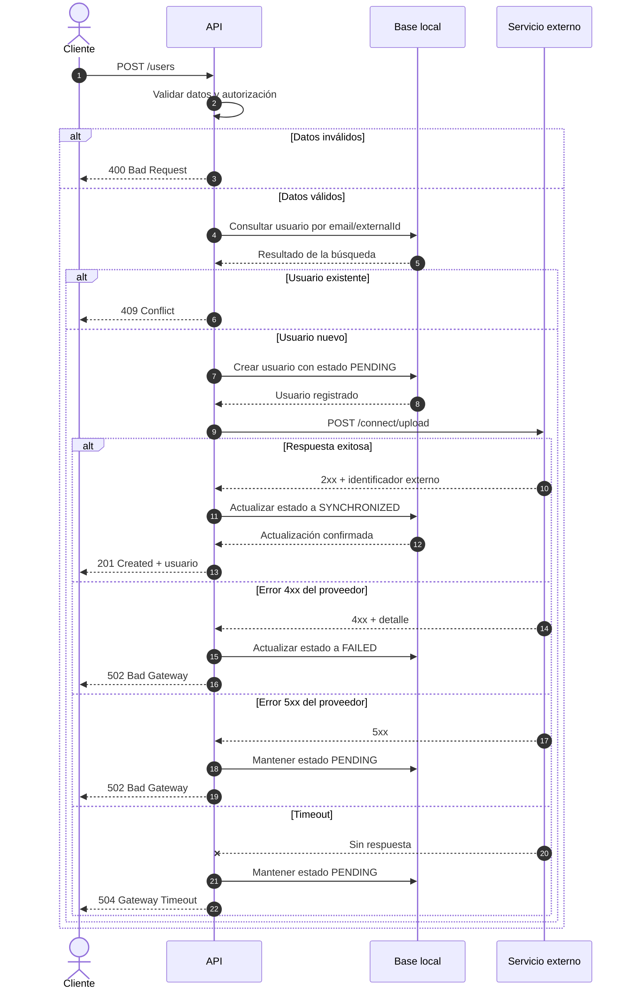
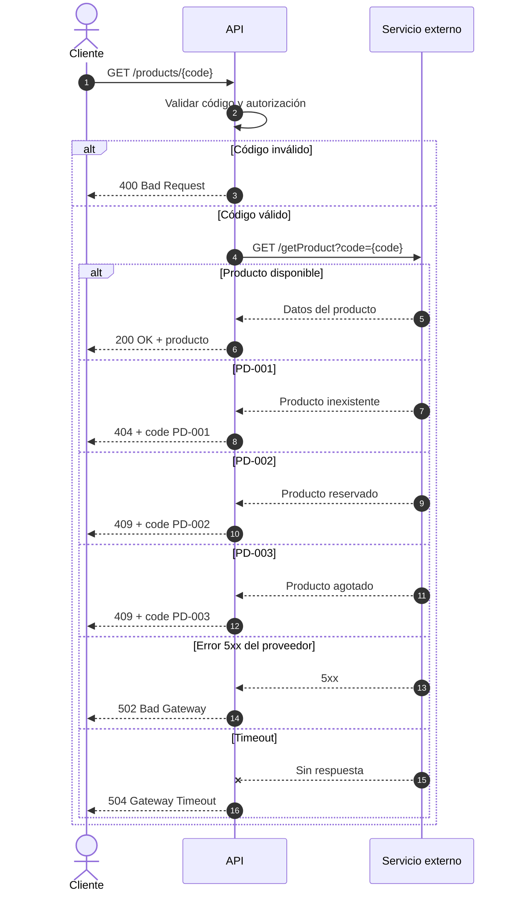
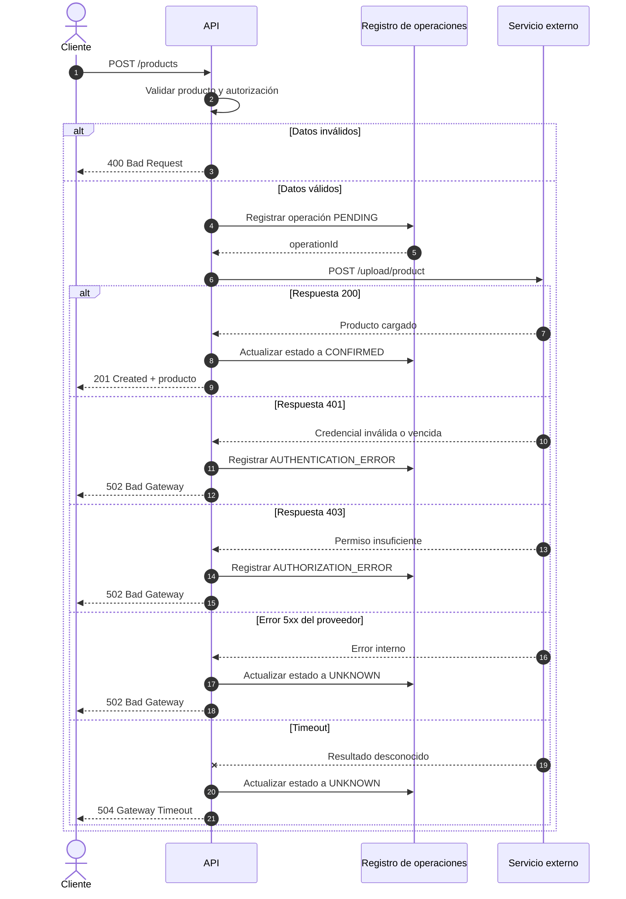

# 4. Integración con servicio externo de inventario

## 1. Alcance y contratos

La API ofrece tres operaciones independientes:

1. Alta de usuario y registro en el servicio externo.
2. Consulta del estado de un producto.
3. Carga de un producto en el servicio externo.

Como la consigna no especifica métodos HTTP, estructuras de los mensajes ni autenticación, se proponen los siguientes contratos. El mecanismo de autenticación debería confirmarse con el proveedor.

| Operación | API local | Servicio externo | Resultado local |
| --- | --- | --- | --- |
| Alta de usuario | `POST /users` | `POST /connect/upload` | `201` si ambas altas son exitosas |
| Consultar producto | `GET /products/{code}` | `GET /getProduct?code={code}` | `200`, `404`, `409` según el resultado |
| Cargar producto | `POST /products` | `POST /upload/product` | `201` si el proveedor responde `200` |

El servicio externo se considera la fuente de verdad del inventario. La base local conserva los usuarios y el estado de las operaciones de integración

## 2. Traducción de respuestas

| Respuesta externa | Significado | Respuesta local propuesta |
| --- | --- | --- |
| Producto disponible | Consulta exitosa | `200` OK |
| PD-001 | El producto no existe | `404` Not Found |
| PD-002 | El producto está reservado | `409` Conflict |
| PD-003 | El producto está agotado | `409` Conflict |
| 200 en la carga | Producto cargado | `201` Created |
| 401 en la carga | Credencial externa inválida o vencida | `502` Bad Gateway |
| 403 en la carga | La integración no tiene permisos | `502` Bad Gateway |
| Error 5xx del proveedor | Falla del proveedor | `502` Bad Gateway |
| Timeout | No se pudo confirmar el resultado | `504` Gateway Timeout |

Los errores 401 y 403 del proveedor no se devuelven directamente al cliente porque corresponden a la autenticación entre nuestra API y el proveedor, no necesariamente a la autenticación del usuario.

## 3. DSS de la integración

El DSS se divide en tres escenarios porque cada operación puede ejecutarse de manera independiente.

### 1. Alta de usuario

El estado PENDING se mantiene cuando el resultado es incierto. Un timeout no garantiza que el proveedor no haya procesado el alta, por lo que la operación debe reconciliarse antes de volver a enviarla.

### 2. Consulta de producto

La respuesta muestra el estado del producto al momento de la consulta. No implica una reserva de stock

### 3. Carga de producto

Una carga con estado UNKNOWN no debe repetirse automáticamente porque podría duplicar el producto. Antes de reintentar se debe consultar el resultado o utilizar la misma clave de idempotencia, si el proveedor ofrece ese mecanismo

## 4. Consideraciones de integración

- Utilizar HTTPS, aunque las URLs de la consigna están expresadas con HTTP
- Aplicar mecanismo de autenticación definido por el proveedor y almacenar las credenciales de forma segura
- Configurar tiempos máximos de conexión y respuesta.
- Registrar operationId, endpoint, fecha, resultado y código externo e identificador de correlación
- No guardar tokens, credenciales ni información sensible en los logs
- No reintentar automáticamente errores funcionales como PD-001, PD-002, PD-003, 400 o 403
- Reintentar errores transitorios únicamente cuando la operación sea segura o el proveedor admita idempotencia
- Reconciliar las operaciones que hayan quedado en estado PENDING o UNKNOWN